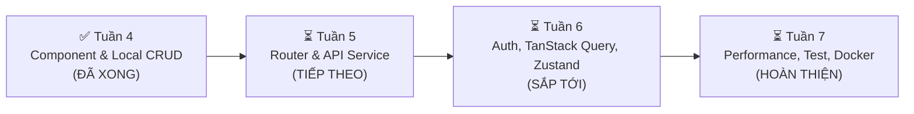

#  NHẬT KÝ THỰC TẬP & KẾ HOẠCH CHI TIẾT (REACT DEVELOPER)
> **Dự án:** Hệ thống Quản lý Sản phẩm (Product Management Dashboard & To-Do List)  
> **Lộ trình:** Giai đoạn 2 — Thực hành bài tập (Tuần 4 – Tuần 7)  
> **Vị trí thư mục:** `c:\Users\Admin\OneDrive\Máy tính\thực tập`  
> **Mục đích file này:** Ghi lại toàn bộ tiến độ, kiến trúc mã nguồn và kế hoạch các tuần tiếp theo để có thể tiếp tục làm việc ngay ở phiên sau mà không cần nhắc lại từ đầu.

---

##  TỔNG QUAN TIẾN ĐỘ

| Tuần | Nội Dung Trọng Tâm | Trạng Thái |
| :--- | :--- | :---: |
| **Tuần 4** | **Thực hành Component, Form Validation (Zod), Custom Hooks, Local State CRUD** | **100% Hoàn thành** |
| **Tuần 5** | **Thực hành Router & API (Axios, Generics, .env, 3 trạng thái)** | **Sẵn sàng triển khai** |
| **Tuần 6** | **Authentication, TanStack Query, Zustand, Feature-based, Husky** | Chờ triển khai |
| **Tuần 7** | **Performance, Vitest Unit Test, Service Worker, Docker & Deploy** | Chờ triển khai |

---

##  KẾT QUẢ ĐÃ ĐẠT ĐƯỢC Ở TUẦN 4

### 1. Công nghệ & Thư viện đã cài đặt
- **Core:** React 19 (`react`, `react-dom`), TypeScript 6, Vite 8
- **Styling:** Tailwind CSS v4 (`@tailwindcss/vite`, `tailwindcss`), Lucide React icons (`lucide-react`)
- **Form & Validation:** `react-hook-form`, `zod@^3.23.8`, `@hookform/resolvers`
- **Utilities:** `clsx`, `tailwind-merge`
- **Version Control:** Git đã được khởi tạo và commit lưu trữ sạch sẽ

### 2. Các module & component đã xây dựng
- [`src/components/common/`](file:///c:/Users/Admin/OneDrive/M%C3%A1y%20t%C3%ADnh/th%E1%BB%B1c%20t%E1%BA%ADp/src/components/common):
  - `Badge.tsx`: Huy hiệu trạng thái *Còn hàng* (xanh), *Sắp hết* (cam), *Hết hàng* (đỏ).
  - `Button.tsx`: Button đa biến thể (primary, outline, danger, ghost), hỗ trợ loading & icons.
  - `Card.tsx`: Khung giao diện card đồng nhất (`CardHeader`, `CardContent`).
  - `Input.tsx`: Input hỗ trợ `forwardRef` tương thích React Hook Form, hiển thị lỗi Zod.
  - `Select.tsx`: Dropdown chọn danh mục/trạng thái với arrow icon tùy biến.
  - `Modal.tsx`: Hộp thoại modal đạt chuẩn accessibility (backdrop blur, ESC key, click outside).
  - `Pagination.tsx`: Thanh phân trang linh hoạt (`< 1 2 3 4 5 >`, chọn số bản ghi mỗi trang).
  - `Toast.tsx`: Thông báo trạng thái góc màn hình tự ẩn sau 3.5s.
- [`src/components/products/`](file:///c:/Users/Admin/OneDrive/M%C3%A1y%20t%C3%ADnh/th%E1%BB%B1c%20t%E1%BA%ADp/src/components/products):
  - `ProductForm.tsx`: Form thêm mới sản phẩm đầy đủ trường (tên, danh mục, giá, số lượng, mô tả, ảnh), validate Zod chặt chẽ, nút Làm mới.
  - `ProductTable.tsx`: Bảng danh sách sản phẩm, sắp xếp cột (Sort), xuất file CSV/Excel (`Xuất Excel`), thao tác sửa/xóa.
  - `ProductFilters.tsx`: Bộ lọc kết hợp tìm kiếm tên (Debounce), lọc danh mục, lọc trạng thái.
  - `ProductEditModal.tsx`: Modal chỉnh sửa nạp sẵn dữ liệu cũ, validate lại trước khi lưu.
  - `ProductDeleteModal.tsx`: Modal cảnh báo xác nhận xóa.
- [`src/components/todos/TodoListApp.tsx`](file:///c:/Users/Admin/OneDrive/M%C3%A1y%20t%C3%ADnh/th%E1%BB%B1c%20t%E1%BA%ADp/src/components/todos/TodoListApp.tsx):
  - Ứng dụng To-do List phụ tích hợp tab chuyển đổi theo đúng hình minh họa trong tài liệu.
- [`src/hooks/`](file:///c:/Users/Admin/OneDrive/M%C3%A1y%20t%C3%ADnh/th%E1%BB%B1c%20t%E1%BA%ADp/src/hooks):
  - `useLocalStorage.ts`: Đồng bộ và lưu trữ dữ liệu vào trình duyệt, F5 không mất.
  - `useDebounce.ts`: Trì hoãn gõ phím 250ms cho ô tìm kiếm.
  - `usePagination.ts`: Tách toàn bộ thuật toán tính toán phân trang ra khỏi UI.
- [`src/schemas/productSchema.ts`](file:///c:/Users/Admin/OneDrive/M%C3%A1y%20t%C3%ADnh/th%E1%BB%B1c%20t%E1%BA%ADp/src/schemas/productSchema.ts):
  - Schema validate tên >= 3 ký tự, giá >= 1.000 ₫, số lượng >= 0, chọn đúng danh mục.
- [`src/App.tsx`](file:///c:/Users/Admin/OneDrive/M%C3%A1y%20t%C3%ADnh/th%E1%BB%B1c%20t%E1%BA%ADp/src/App.tsx):
  - Dashboard tổng thể với thanh thống kê KPI (Tổng sản phẩm, Còn hàng, Sắp hết, Hết hàng, Tổng giá trị kho hàng).

---

##  KẾ HOẠCH HÀNH ĐỘNG CHI TIẾT CÁC TUẦN TIẾP THEO

###  BƯỚC TIẾP THEO: TUẦN 5 — THỰC HÀNH ROUTER & API

#### 1. Mục tiêu cần đạt theo giáo trình:
- Thiết lập hệ thống routing nhiều cấp (Nested Route), truyền nhận tham số qua URL (`/products/:id`, `?page=1&category=...`).
- Xây dựng tầng API Service tách biệt hoàn toàn khỏi UI, có định kiểu TypeScript rõ ràng.
- Áp dụng TypeScript Generics (`ApiResponse<T>`, `PaginatedResponse<T>`) và Utility Types (`Pick`, `Omit`, `Partial`).
- Cấu hình Axios Instance + Interceptor (tự động gắn token, xử lý lỗi tập trung 401, 403, 500, cấu hình file `.env`).
- Hoàn thành trọn vẹn luồng nghiệp vụ CRUD kết nối API thật: `List -> Detail -> Create -> Edit -> Delete`.
- Xử lý đủ 3 trạng thái cho mọi màn hình: **Loading (Đang tải)**, **Error (Lỗi)**, **Empty (Không có dữ liệu)**.

#### 2. Checklist công việc cần làm ở Tuần 5:
- [ ] Cài đặt `react-router-dom` và `axios`.
- [ ] Tạo file cấu hình môi trường `.env` (`VITE_API_BASE_URL`).
- [ ] Tạo cấu trúc thư mục API:
  - `src/services/api/axiosClient.ts`: Cấu hình base URL, timeout, request/response interceptors.
  - `src/services/api/productApi.ts`: Các hàm gọi API `getAll`, `getById`, `create`, `update`, `delete`.
- [ ] Xây dựng Types generic chuẩn:
  - `src/types/api.ts`: Định nghĩa `ApiResponse<T>`, `ApiError`, `PaginationParams`.
- [ ] Thiết lập hệ thống Router:
  - Cấu hình `createBrowserRouter` hoặc `<Routes>`:
    - Route `/` hoặc `/dashboard`: Màn hình tổng quan & danh sách sản phẩm.
    - Route `/products/:id`: Màn hình xem chi tiết sản phẩm.
    - Route `/products/create`: Trang tạo mới sản phẩm riêng biệt hoặc qua route con.
  - Đồng bộ `search`, `category`, `page` với URL Search Params (`useSearchParams`).
- [ ] Thiết lập Mock Server API (sử dụng **MockAPI.io** hoặc **json-server**) để test kết nối mạng HTTP thực tế.
- [ ] Xây dựng UI Component xử lý 3 trạng thái:
  - `SkeletonTable.tsx`: Hiệu ứng shimmer khi đang tải dữ liệu.
  - `ErrorBanner.tsx`: Hiển thị lỗi mạng kèm nút "Thử lại" (Retry).
  - `EmptyState.tsx`: Giao diện khi kết quả rỗng.

---

###  TUẦN 6 — AUTHENTICATION, TANSTACK QUERY & KIẾN TRÚC DOANH NGHIỆP

#### 1. Mục tiêu cần đạt:
- Chức năng Đăng nhập / Đăng xuất, lưu và kiểm tra token an toàn.
- Cấu hình `<ProtectedRoute />` theo trạng thái đăng nhập và phân quyền Role (Admin vs User/Staff).
- Chuyển toàn bộ quản lý dữ liệu server sang **TanStack Query (React Query v5)** (caching, stale time, `invalidateQueries` sau khi thêm/sửa/xóa).
- Quản lý Global State (thông tin người dùng, auth state, giỏ hàng/thông báo) bằng **Zustand**.
- Refactor source code theo kiến trúc **Feature-based** (`src/features/auth`, `src/features/products`, `src/shared`).
- Áp dụng ít nhất 1 Design Pattern (**Compound Component** hoặc **HOC**) cho nhóm component dùng chung.
- Cấu hình **ESLint + Prettier**, tích hợp **Husky + lint-staged** tự động chặn commit vi phạm.

#### 2. Checklist công việc:
- [ ] Cài đặt `@tanstack/react-query`, `@tanstack/react-query-devtools`, `zustand`, `husky`, `lint-staged`.
- [ ] Xây dựng Auth module:
  - `useAuthStore.ts` (Zustand): `user`, `token`, `login()`, `logout()`.
  - Component `<ProtectedRoute />` chặn truy cập trái phép.
- [ ] Refactor gọi API sang React Query:
  - `useProductsQuery()`, `useProductQuery(id)`, `useCreateProductMutation()`, `useUpdateProductMutation()`, `useDeleteProductMutation()`.
  - Invalidate cache đúng thời điểm để danh sách tự cập nhật ngay lập tức.
- [ ] Tổ chức lại thư mục theo Feature-based.
- [ ] Triển khai Compound Component Pattern (ví dụ: `<Dialog>`, `<Tabs>`).
- [ ] Setup file `.husky/pre-commit` chạy `npx lint-staged`.

---

###  TUẦN 7 — TỐI ƯU HIỆU NĂNG, KIỂM THỬ, DOCKER & TRIỂN KHAI PRODUCTION

#### 1. Mục tiêu cần đạt:
- Tối ưu hiệu năng ứng dụng: Đo lường re-render bằng **React DevTools Profiler**, áp dụng `React.memo`, `useMemo`, `useCallback` đúng chỗ.
- Áp dụng **Code Splitting & Lazy Loading** với `React.lazy()` và `<Suspense />` cho các route.
- Xử lý lỗi toàn cục với **Error Boundary** (không để trang bị crash trắng).
- Viết Unit Test cơ bản bằng **Vitest + React Testing Library** (test render, click, form validate).
- Tích hợp **Service Worker / Vite PWA** cache tài nguyên tĩnh, hỗ trợ trải nghiệm offline.
- Đo điểm **Web Vitals** (LCP, CLS, INP) bằng Google Lighthouse trước và sau tối ưu.
- Viết `Dockerfile` chuẩn multi-stage (Node builder + Nginx Alpine), build image và chạy container.
- Build bản production và deploy lên **Vercel / Netlify**, hoàn thiện Mini Project tổng hợp.

#### 2. Checklist công việc:
- [ ] Dùng React DevTools Profiler ghi nhận số liệu render trước tối ưu.
- [ ] Triển khai `React.lazy` cho các trang route.
- [ ] Viết component `ErrorBoundary.tsx`.
- [ ] Cài đặt `vitest`, `@testing-library/react`, `@testing-library/jest-dom`.
- [ ] Viết bộ test cases cho `ProductForm` và `ProductTable`.
- [ ] Cấu hình Service Worker PWA.
- [ ] Chạy audit Google Lighthouse, xuất file báo cáo điểm số.
- [ ] Viết file `Dockerfile` và `.dockerignore`.
- [ ] Deploy dự án lên Vercel / Netlify và kiểm tra đường link live.

---